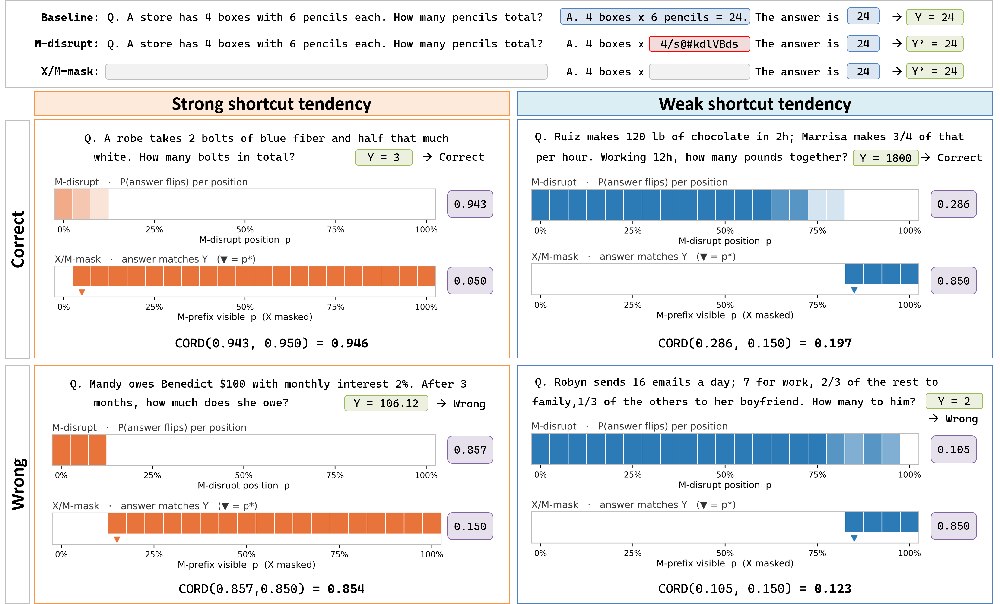

# CORD - Causally Redundant Reasoning

Code for **CORD** (*Causal Redundancy of Reasoning via Disruption*), a
dual-disruption metric that scores how *shortcut-like* a chain-of-thought (CoT)
is: how much a model's answer is determined **without** the information in its
own reasoning path.

Paper: *Causally Redundant Reasoning: A Dual Disruption Test Framework for
Measuring Shortcut Tendencies in Chain of Thought.*


## Install

```bash
pip install -e .            # metric/analysis layer (numpy)
pip install -e ".[measure]" # + torch, transformers, vllm (to run generation)
pip install -e ".[dev]"     # + pytest
```

The paper's measurements were run with torch 2.10.0 (CUDA 12.8),
transformers 4.57.6 and vLLM 0.19.0.

---

## The metric

CORD combines two disruption axes as a harmonic mean of two instance-level
scalars (paper Eq. 9):

```
CORD(X) = H( a_bar(X), q*_B(X) )           where H(x, y) = 2xy / (x + y),  H(0,0) = 0
```

| Axis | Question | Signal | Component |
|---|---|---|---|
| **A - necessity** (inverse decoding) | Does changing M change Y? | `a(p,r) = 1[Y_A(p,r) == Y_0]` | `a_bar` = mean of `a` over the full PxR grid (Eq. 7) |
| **B - sufficiency** (X-mask recovery) | Can M recover Y once X is hidden? | `b(p) = 1[Y_B(p) == Y_0]` | `q*_B = 1 - p*_B/100`, where `p*_B = min{p : b(p) = 1}`, or `max(P)` if never (Eq. 8) |

CORD -> 1 is a strong shortcut signature (answer robust to M-disruption **and**
recoverable from a short M-prefix); CORD -> 0 is weak.

<p align="center">
  
</p>

*Top: the baseline and the two disruptions on a toy question. **M-disrupt** is
the A-axis (necessity): M is overwritten from position p onward and the answer
is re-read. **X/M-mask** is the B-axis (sufficiency): X and all but the first
p% of M are hidden. Bottom: four GSM8K questions with strong (left) and weak (right)
shortcut tendency, split by whether the model's answer Y is correct. The
M-disrupt strip shades P(answer flips) at each p, and its box is `a_bar`. The
X/M-mask strip marks the positions where the answer matches Y, with ▼ at
`p*_B`. Its box is `p*_B/100`, so the B input to CORD is
`q*_B = 1 - p*_B/100` (e.g. 0.050 -> 0.950).*

The measurement grid is `P = {0, 5, ..., 100}` (21 positions, % of M) and
`R = {bottom-1, bottom-5, bottom-10, top-5, top-10}` (5 token-rank bands);
see `crr.config`.

---

## Quickstart

### 1. Scalar - from the two components
```python
from crr import cord

cord(a_mean=0.70, p_star=40)      # -> 0.646
```

### 2. From the raw grid
```python
import numpy as np
from crr import score

a = np.ones((21, 5))                              # a(p,r) over PxR
b = np.array([1.0 if p >= 20 else 0.0 for p in range(0, 101, 5)])
r = score(a, b, p_values=list(range(0, 101, 5)))  # -> CordResult
r.cord, r.a_mean, r.p_star, r.b_comp             # typed attributes
float(r)                                          # 0.889  (== r.cord)
```

### 3. From raw measurement rows
Reads one question's rows from a measurement cell written by `scripts/02_run_axis_a.py`
and `scripts/03_run_axis_b.py` (or from the released paper outputs, same layout).
```python
import json
from crr.metric.grid import build_a_matrix, build_b_curve
from crr import score
import crr.config as cfg

def read_jsonl(path):
    with open(path) as f:
        return [json.loads(line) for line in f if line.strip()]

cell = "results/Qwen2.5-Math-7B-Instruct/math500"   # <results-dir>/<model>/<task>
exp_a_rows = read_jsonl(f"{cell}/experiment_a.jsonl")
exp_b_rows = read_jsonl(f"{cell}/experiment_b.jsonl")
qid = 0

a = build_a_matrix(exp_a_rows, qid, cfg.POSITION_GRID, cfg.RANK_GRID)   # (21, 5)
b = build_b_curve(exp_b_rows, qid, cfg.POSITION_GRID, mask_unit="token")  # (21,)
result = score(a, b, cfg.POSITION_GRID)
print(result)  # CordResult(cord=..., a_mean=..., p_star=..., b_comp=...)
```

### 4. End to end - measuring one question (needs `[measure]` and a GPU)
Generates the baseline CoT, runs both disruption axes over the full grid, and
scores CORD, following the paper's pipeline: plain generation (baseline, A-axis
answers) runs on vLLM; the two steps that need model internals run on HF
transformers - A-axis token selection needs per-position logits over the CoT,
and the B-axis needs a custom attention mask over the question span. Both are
held on one GPU (a 7B model fits in 48 GB).

```python
import crr.config as cfg
from crr import score
from crr.answers import extract_answer
from crr.axes.necessity import (
    set_special_tokens, compute_baseline_logits, select_inverse_tokens, build_edited_prompt,
)
from crr.axes.sufficiency import recover_under_xmask
from crr.judge import judge_shortcut
from crr.metric.grid import build_a_matrix, build_b_curve
from crr.models.chat_template import render_chat
from crr.models.generation import vllm_batch_generate
from crr.models.loader import load_model_and_tokenizer, load_vllm_engine, unload_vllm_engine
from crr.prompts import ANSWER_CUE, SYSTEM_PROMPT

MODEL = "Qwen/Qwen2.5-Math-7B-Instruct"
config = {"models": [{"name": MODEL, "dtype": "bfloat16", "gpu_memory_utilization": 0.5}]}
engine, tok = load_vllm_engine(config)       # generation
model, _ = load_model_and_tokenizer(config)  # logits + attention masking
set_special_tokens(tok)  # exclude special / non-Latin tokens from inverse selection

def generate(prompts, max_new_tokens):
    return vllm_batch_generate(engine, tok, prompts, max_new_tokens=max_new_tokens)

# GSM8K test split, index 0 (openai/gsm8k, "main"; gold answer 18).
question = ("Janet’s ducks lay 16 eggs per day. She eats three for breakfast every morning and "
            "bakes muffins for her friends every day with four. She sells the remainder at the "
            "farmers' market daily for $2 per fresh duck egg. How much in dollars does she make "
            "every day at the farmers' market?")
# R1-Distill / deepseek-math templates take no system turn: append SYSTEM_PROMPT
# to the user turn instead (see crr.models.chat_template.uses_user_only_chat).
prompt = render_chat(tok, [{"role": "system", "content": SYSTEM_PROMPT},
                           {"role": "user", "content": question}])

# Baseline: free CoT M, then the answer Y_0 behind a fixed answer cue.
gen = generate([prompt], 2048)[0]
cot_ids = gen["generated_ids"]  # as returned by vLLM (ends with EOS when generation stops)
cot_text = tok.decode(cot_ids, skip_special_tokens=True)
ans = generate([prompt + cot_text + ANSWER_CUE], 64)[0]["generated_text"]
y0 = extract_answer("\\boxed{" + ans)

# A-axis (necessity): from p% of M onward, replace M with rank-r tokens, re-answer.
prompt_ids = tok(prompt, return_tensors="pt")["input_ids"].to(model.device)
logits, prompt_len = compute_baseline_logits(model, prompt_ids, cot_ids)
grid = [(r, p) for r in cfg.RANK_GRID for p in cfg.POSITION_GRID]
edited = [build_edited_prompt(tok, prompt, select_inverse_tokens(
              logits, prompt_len, cot_ids, r, p)["edited_cot_ids"]) for r, p in grid]
exp_a = [{"query_id": 0, "condition_type": "main", "rank_position": r, "intervention_point": p,
          "is_shortcut": judge_shortcut("\\boxed{" + out["generated_text"], y0)["is_shortcut"]}
         for (r, p), out in zip(grid, generate(edited, 256))]

# B-axis (sufficiency): mask the question X and all but the first p% of M, re-answer.
exp_b = []
for p in cfg.POSITION_GRID:
    out = recover_under_xmask(model, tok, question=question, cot_text=cot_text,
                              cot_token_ids=cot_ids, p_visible=p, mask_unit="token",
                              model_name=MODEL)
    exp_b.append({"query_id": 0, "condition_type": "main", "mask_unit": "token",
                  "p_visible": p, "is_shortcut": judge_shortcut(out["full_cot"], y0)["is_shortcut"]})

# CORD
a = build_a_matrix(exp_a, 0, cfg.POSITION_GRID, cfg.RANK_GRID)
b = build_b_curve(exp_b, 0, cfg.POSITION_GRID, mask_unit="token")
print(score(a, b, cfg.POSITION_GRID, baseline_cot=cot_text, baseline_answer=y0))
# -> CordResult(cord=0.222, a_mean=0.429, p_star=85, b_comp=0.15)  (Y_0 = 18)

unload_vllm_engine(engine)  # shut the vLLM engine down cleanly before exit
```

---

## Reproducing the paper tables

`scripts/` regenerates every measurement behind the main-text Tables 1-6 and
computes the tables. Install the measurement and reproduction extras first:

```bash
pip install -e ".[measure,repro]"
```

Run steps 1-4 for each of the 6 models x 2 tasks (`common.MODELS`, `common.TASKS`),
and steps 5-6 for Qwen2.5-Math-7B-Instruct on both tasks (Table 4):

```bash
M=Qwen/Qwen2.5-Math-7B-Instruct; T=gsm8k
python scripts/01_generate_baseline.py    --model $M --task $T   # baseline CoT + Y_0 (vLLM)
python scripts/02_run_axis_a.py           --model $M --task $T   # A-axis, 5 ranks x 21 positions
python scripts/03_run_axis_b.py           --model $M --task $T   # B-axis, X/M-mask, 21 positions
python scripts/04_run_early_answering.py  --model $M --task $T   # Early Answering (Table 6)
python scripts/05_run_self_refine.py      --model $M --task $T   # self-refine (Table 4)
python scripts/06_measure_refined.py      --model $M --task $T   # refined CoT on both axes (Table 4)
python scripts/make_tables.py                                     # -> results/tables/tables.{json,md}
```

| Table | Content | Inputs |
|---|---|---|
| 1 | mean CORD, baseline accuracy | `baseline`, `experiment_a`, `experiment_b` (all 12 cells) |
| 2 | CORD difference by CoT-length quartile | same, aligned R1-Distill pairs |
| 3 | headline paired Wilcoxon | same, aligned R1-Distill pairs |
| 4 | CORD on baseline vs refined CoT | Qwen-Math `experiment_a/b` + `refine/` (steps 5-6) |
| 5 | relationship between the two CORD components | per-instance a_bar, q*_B from `experiment_a/b` |
| 6 | CORD vs Early Answering | `ea/` + per-instance CORD |

- Each step writes under `--results-dir` (default `results/`; layout in
  `scripts/common.py`). `make_tables.py` skips cells that are not measured yet
  and lists them, so a partial run can be checked before all 12 cells exist. Steps 2 and 3 resume an interrupted run. `--limit N`
  runs the first N questions only.

### Released measurement outputs

The raw outputs behind every computed table in the paper are on the Hugging
Face Hub as
[jw-kim/cord-paper-results](https://huggingface.co/datasets/jw-kim/cord-paper-results)
(1.5 GB, same layout as `results/`). To compute the tables without re-running
the measurements:

```bash
hf download jw-kim/cord-paper-results --repo-type dataset --local-dir paper_results
python scripts/make_tables.py --results-dir paper_results    # -> results/tables/tables.{json,md}
```

The dataset card lists the files per table and the few settings that differ
from the current script defaults.

### Appendix tables

Appendix tables that need only the outputs above (no new generation):

```bash
python scripts/appendix/make_appendix_tables.py    # -> results/tables/appendix_tables.{json,md}
```

Appendix tables that need extra measurements live in `appendix_experiments/`:

```bash
# Table 8 - alternative necessity-side disruptions (GSM8K, R1D-Qwen and Qwen-Math)
python appendix_experiments/disruption/run_operators.py --model $M --task gsm8k
python appendix_experiments/disruption/make_table8.py    # -> results/tables/table8.json

# Tables 24-27 - self-refine analyses (needs step 5 for the four non-R1-Distill models)
python appendix_experiments/refine/run_refine_ablations.py --model Qwen/Qwen2.5-Math-7B-Instruct  # Table 24
python appendix_experiments/refine/run_resample.py         --model $M --task math500              # Table 25
python appendix_experiments/refine/run_base_mmask.py       --model Qwen/Qwen2.5-Math-7B-Instruct  # Table 26
python appendix_experiments/refine/make_refine_tables.py    # -> results/tables/refine_tables.json
```

---

## Package layout

```
crr/
  config.py            measurement grid (PxR)
  prompts.py           SYSTEM_PROMPT and ANSWER_CUE shared by all measurements
  metric/
    cord.py            canonical metric: cord, score, CordResult
    early_answering.py Early Answering score (comparison baseline)
    grid.py            a-matrix / b-curve / p*_B cutoff
    types.py           AMatrix, BCurve, PGrid aliases
  axes/                the two disruption axes             (needs [measure])
    necessity.py         A-axis: inverse decoding
    sufficiency.py       B-axis: X-mask recovery
  models/              loader, chat_template, generation (greedy / vLLM)
  answers/
    extract.py           answer extraction / checking / correctness
    leak.py              first occurrence of the answer in the CoT
    no_answer.py         classification of unextractable answers
  judge.py             shortcut judgment (answer == baseline answer?)
  selfrefine.py        self-refine prompts (Sec. 4.3 validation)
scripts/               reproduction of the paper tables (see above)
  01-06_*.py             measurement steps (main-text Tables 1-6)
  make_tables.py         main-text Tables 1-6
  appendix/              appendix tables computed from the same outputs
  common.py              models, tasks, budgets, results layout
appendix_experiments/  appendix tables that need extra measurements (outside crr)
  disruption/            Table 8: alternative necessity-side disruptions
  refine/                Tables 24-27: self-refine ablations, X-only resampling,
                         baseline M-mask
tests/                 metric, grid/cutoff, answer matching, no-answer tagging,
                       measurement layer on synthetic logits (CPU)
```

---

## API reference

### `crr` (top level)
| Symbol | Signature | Purpose |
|---|---|---|
| `cord` | `cord(a_mean, p_star) -> float` | CORD from components |
| `score` | `score(a_matrix, b_curve, p_values, baseline_cot="", baseline_answer="", saturation_threshold=0.95, cutoff_mode="A1") -> CordResult` | CORD from the raw grid |
| `CordResult` | `NamedTuple(cord, a_mean, p_star, b_comp)` | `float(r) == r.cord` |

### `crr.metric`
- **`cord`** - also exposes `harmonic_mean`, `a_component`, `b_component`.
- **`early_answering`** - `ea_shortcut_score_integral`, the Early Answering
  score (Lanham et al. 2023) used as a comparison baseline (Sec. 5.2).
- **`grid`** - `build_a_matrix`, `build_b_curve`, `compute_p_star`
  (cutoff modes `A1`/`A2`/`A3`), `trapz_normalized`.

### `crr.config`
`POSITION_GRID` (21 points, % of M) and `RANK_GRID` (5 token-rank bands).

### Measurement layer (needs `[measure]`)
| Module | Key symbols |
|---|---|
| `axes.necessity` | `set_special_tokens`, `compute_baseline_logits[_batched]`, `select_inverse_tokens[_batched_view]`, `build_edited_prompt` |
| `axes.sufficiency` | `recover_under_xmask[_batched]`, `recover_under_mmask` |
| `models.loader` | `load_model_and_tokenizer`, `load_vllm_engine`, `unload_vllm_engine` |
| `models.generation` | `greedy_generate[_batched]`, `vllm_batch_generate` |
| `models.chat_template` | `render_chat`, `uses_user_only_chat` |
| `prompts` | `SYSTEM_PROMPT`, `ANSWER_CUE` |
| `selfrefine` | `make_critique_prompt`, `make_refine_prompt`, `REFINE_TRIGGER_VARIANTS` |

### Answers and judgment
| Module | Key symbols |
|---|---|
| `answers` | `extract_answer`, `check_answer`, `extract_gold_answer`, `normalize_answer_string`, `evaluate_correctness`, `classify_no_answer` |
| `answers.leak` | `normalize`, `first_answer_pos_frac` |
| `judge` | `judge_shortcut` |

---

## Notes

- **Determinism**: all measurements use greedy decoding, so there is no
  sampling noise. Re-running them is still not token-identical: vLLM batched
  greedy decoding (default mode, v0.19) is not run-to-run deterministic,
  because the batch composition depends on request timing and small numerical
  differences change later tokens. In our full re-run every table
  value stayed within this run-to-run noise and all conclusions were unchanged; the released
  measurement outputs reproduce the paper's values exactly.
  `VLLM_ENABLE_V1_MULTIPROCESSING=0` makes vLLM decoding deterministic on a
  fixed GPU type, but its outputs differ from the default mode used for the
  paper, so do not mix the two modes within one comparison.
- **No-answer cells**: when no answer can be extracted after a disruption,
  `judge_shortcut` returns `is_shortcut=None`; `build_a_matrix` / `build_b_curve`
  count such cells as 0 (answer changed), the same as a different answer.
- **Baseline answer**: `Y_0` is extracted leniently (`extract_answer` default):
  structured markers first, otherwise the last number in the text.
- **Inverse-token candidates**: call `set_special_tokens(tokenizer)` once before
  A-axis selection; it excludes special, non-Latin-script and thinking-marker
  tokens (selection raises if it was not called).
- **X/M-mask**: masked tokens stay in place (attention mask 0); token positions
  are unchanged.
- **Stopping**: the HF greedy loop stops on `tokenizer.eos_token_id` only.
- **Tests**: `pytest` runs CPU-only tests (no model download).
  `tests/test_cord_metric.py` pins the CORD definition and its axioms;
  `tests/test_measurement_cpu.py` exercises token selection and prompt
  construction on synthetic logits and is skipped without torch.

---

## Citation

If you use this code or the released measurement outputs, please cite:

```bibtex
@inproceedings{kim2026cord,
  title     = {Causally Redundant Reasoning: A Dual-Disruption Test Framework for Measuring Shortcut Tendencies in Chain-of-Thought},
  author    = {Kim, Jiwoo and Lee, Jongwuk},
  booktitle = {Proceedings of the 2026 Conference on Empirical Methods in Natural Language Processing},
  year      = {2026},
  note      = {To appear}
}
```
